# Control de RR. HH.

[](https://github.com/mmomo/app-rh/actions/workflows/ci.yml)

**Producción:** https://app-rh-iota.vercel.app

Aplicación web para administrar la información del personal. La pantalla de inicio es un panel de resumen (plantilla activa y su evolución, nómina mensual vigente por departamento y ausencias). Incluye empleados (con NSS único y edad mínima de 18 años), permisos con y sin goce de sueldo, vacaciones según la LFT (corresponden, usadas y restantes), aumentos salariales mensuales (con salario vigente automático y respeto al salario mínimo), antigüedad y baja de empleados (el expediente se conserva como ex empleado).

**Stack:** React 19 + Vite 6 + TypeScript, React Router, Vitest + Testing Library + axe-core. Despliegue en Vercel.

## Capturas

Tomadas en producción el 22/11/2026 con datos de demostración. Las imágenes están en `docs/evidencias/capturas/app/`.

| Panel de RH (inicio) | Panel en celular |
|---|---|
| 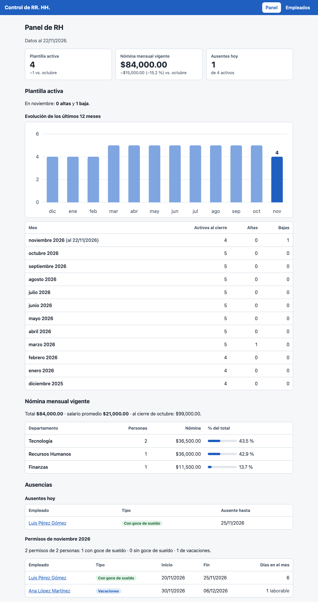 | 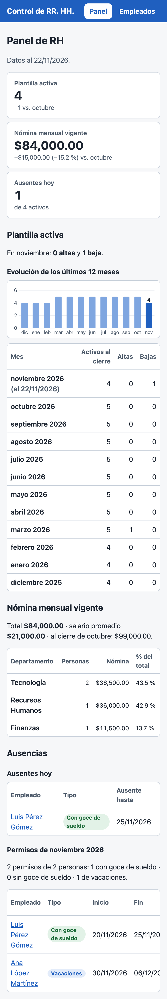 |

| Lista de empleados | Expediente de un empleado |
|---|---|
| 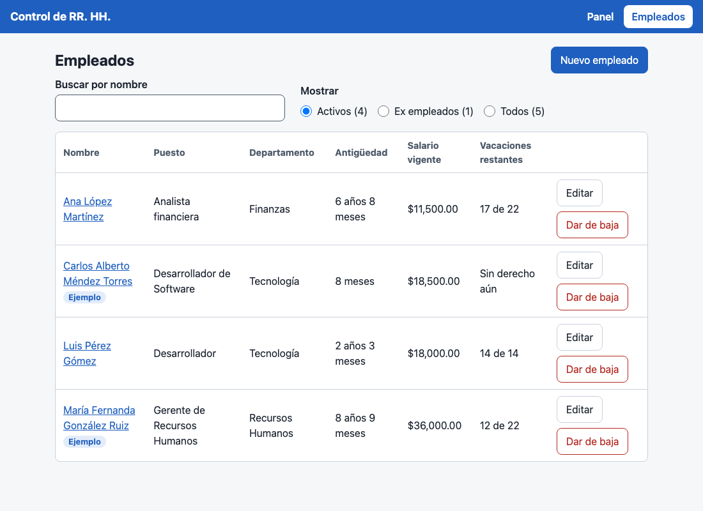 | 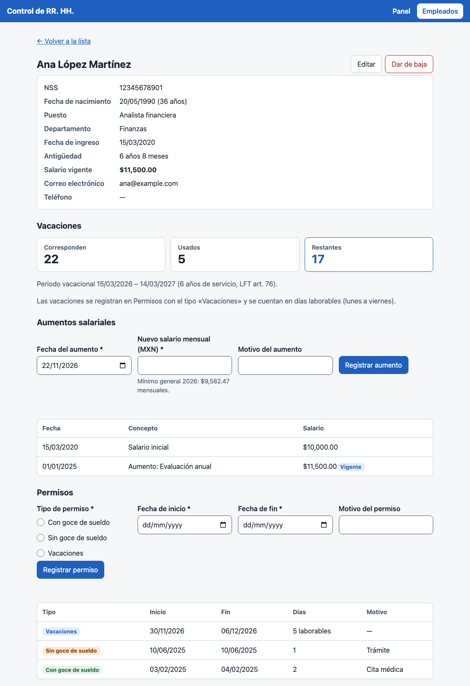 |

## Evolución por iteraciones

La app se construyó en 7 iteraciones del flujo AI-DLC (Inception → Construction → Operations). En cada una se citan los prompts tal como se escribieron; el registro completo está en [`docs/prompts.md`](docs/prompts.md).

Las capturas de esta sección muestran **la versión de cada iteración**: se compiló el código del último commit de la iteración y se cargaron los mismos datos de demostración.

| Iteración | Fecha | Requerimientos | Pruebas al cierre |
|---|---|---|---|
| 1 | 19–20/11/2026 | A1–A5, R1, R2a–R2c | 51 |
| 2 | 20/11/2026 | R3, R4, R5 | 68 |
| 3 | 20/11/2026 | A6, R6 | 88 |
| 4 | 20/11/2026 | A7 | 98 |
| 5 | 20/11/2026 | R7 | 104 |
| 6 | 21/11/2026 | A8, R8 (y R5 ajustada) | 124 |
| 7 | 22/11/2026 | A9 | 144 |

### Iteración 1: CRUD, permisos, aumentos y antigüedad
**Prompts:**
> Lee las instrucciones de claude.md y los requerimientos de docs/requerimientos.md. Crea un repositorio de git y empieza a trabajar con la primera etapa del ciclo de desarrollo de la aplicacion.

> Respuestas a preguntas abiertas: persistencia = localStorage; R2b = salario > 0 y aumento > vigente; R2c = fechas vs. ingreso; A5 = Lighthouse Accesibilidad ≥ 90.

> Sí, apruebo los campos y el plan, adelante

> Sí, adelante con Operations y el despliegue en Vercel

> Sube el repositorio a github (público, usuario mmomo, instalando gh con Homebrew)

> Conecta el repositorio a vercel y agrega pipeline de github actions

**Resultado:**
- alta, consulta, edición y eliminación de empleados;
- permisos con y sin goce de sueldo;
- aumentos con salario vigente automático y antigüedad;
- validaciones de datos obligatorios y fechas;
- Lighthouse Accesibilidad 100;
- despliegue en Vercel, repositorio en GitHub y CI.

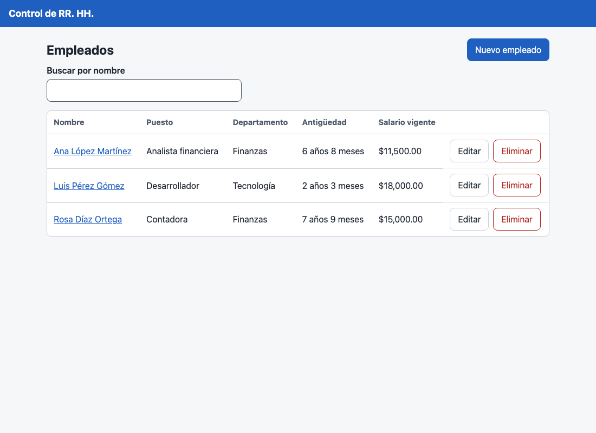 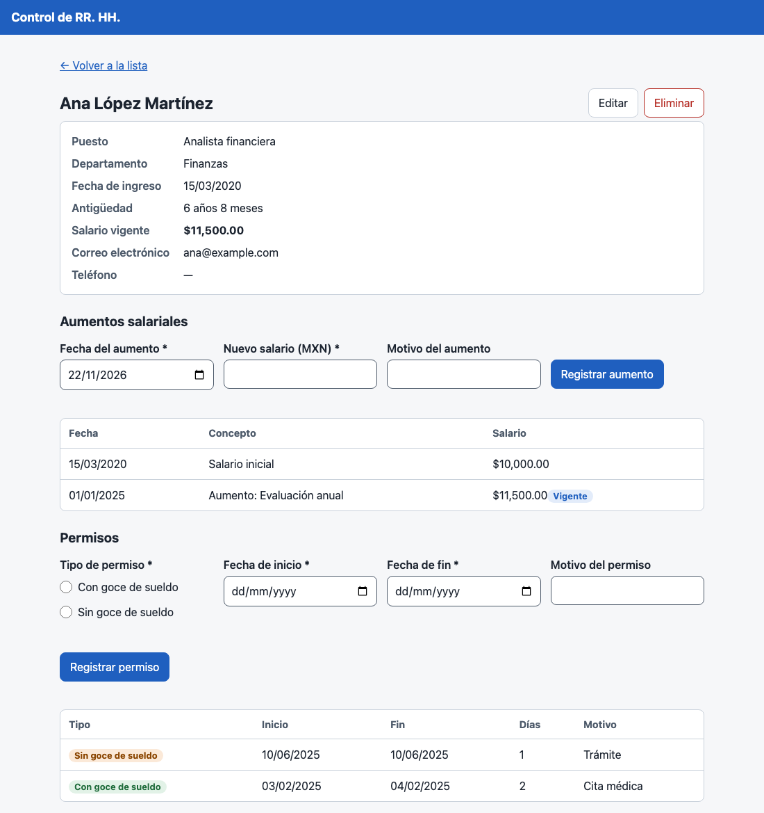

### Iteración 2: salario mínimo, edad mínima y NSS único
**Prompts:**
> Nuevos requerimientos: 1. No se puede registrar un salario por debajo del salario minimo mexicano actual. 2. Edad minima legal, no registrar empleados menores de edad. 3. Cada empleado debe tener un NSS (numero de seguridad social) unico, no deben repetirse. Registra estos nuevos requerimientos y realiza la fase de inception.

> Respuestas: salario mensual; mínimo general para todos; edad a la fecha de ingreso; NSS solo 11 dígitos; empleados existentes se completan al editar.

> Sí, apruebo el plan, adelante con Construction

**Resultado:**
- salario mensual no menor a $9,582.47 (mínimo 2026);
- 18 años cumplidos a la fecha de ingreso;
- NSS de 11 dígitos sin repetir;
- aviso de "Datos incompletos" para los registros anteriores.

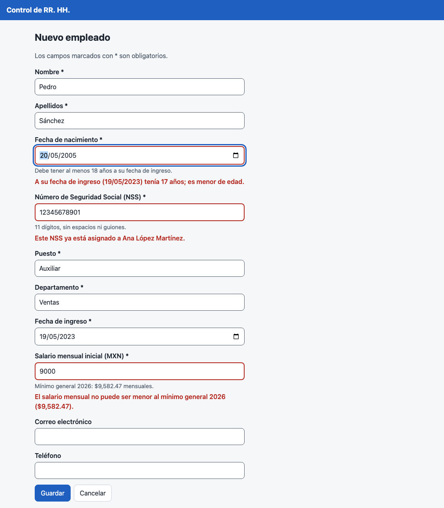

### Iteración 3: vacaciones según la LFT
**Prompts:**
> Nuevo requerimiento: Mostrar los dias de vacaciones disponibles que corresponden a cada empleado, cuantos ha usado y cuantos le quedan.

> Respuestas: vacaciones como tipo de permiso; conteo lunes a viernes; solo periodo vigente; bloquear si excede el saldo.

> Aprobado

> El textfield de nuevo salario mensual no esta a la misma altura que los otros textfields de esa sección. Corrigelo.

**Resultado:**
- días que corresponden según el art. 76 de la LFT, usados y restantes en el periodo vigente;
- vacaciones registradas como tipo de permiso en días laborables;
- columna de vacaciones restantes en la lista;
- formularios en línea con los campos alineados.

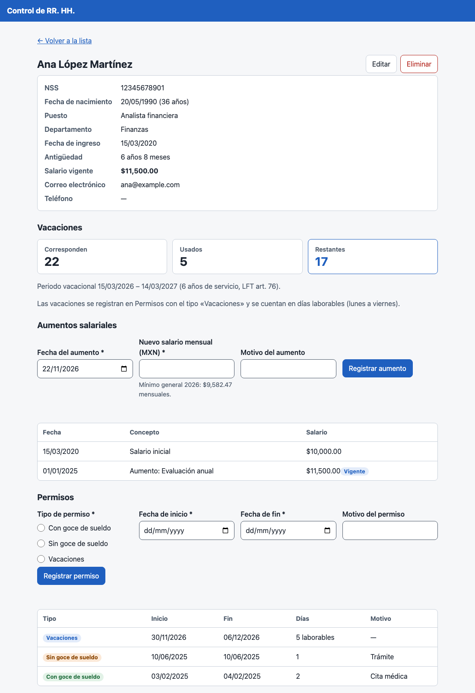

### Iteración 4: empleados de ejemplo
**Prompts:**
> Crea dos empleados default con sus datos que sirvan como ejemplo.

> Siempre presentes

**Resultado:** María Fernanda y Carlos Alberto aparecen siempre con la etiqueta "Ejemplo" y cumplen todas las reglas. En ese momento, a diferencia del resto, no se podían eliminar.

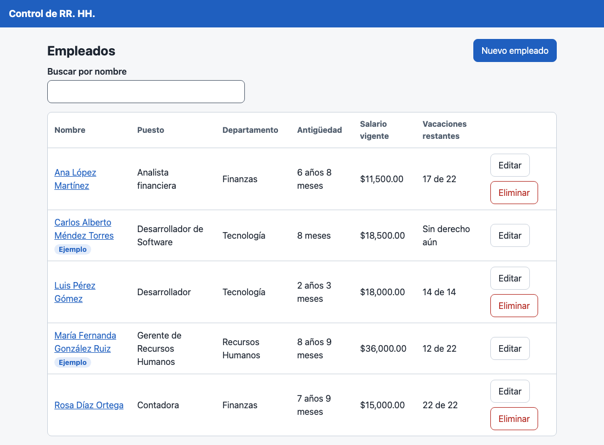

### Iteración 5: límite de 100 años
**Prompts:**
> Nueva restriccion. Empleados no pueden tener más de 100 años de edad ni de contratación. Esto significa, no puede haber un empleado trabajando más de 100 años en la empresa.

> Respuestas: edad a hoy; aviso y bloquear al editar.

> Continua

**Resultado:**
- no se guarda una edad o antigüedad mayor a 100 años;
- los registros que ya rebasan el límite muestran "Supera 100 años" y un enlace para corregirlos.

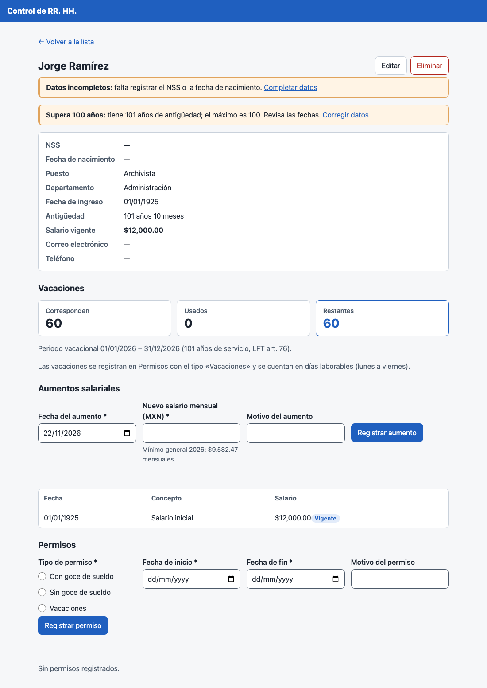

### Iteración 6: baja de empleados
**Prompts:**
> Nuevo requerimiento: En lugar de eliminar un empleado, darlo de baja. Esto significa que ya no es empleado activo, pero se queda el registro del empleado bajo la etiqueta de ex empleado.

> Respuestas: fecha y motivo; filtro Activos / Ex / Todos; baja definitiva; ex empleado solo consulta.

> Apruebo, además apartir de ahora cada vez que despligues cambios, toma screenshots de la app

**Resultado:**
- "Dar de baja", con fecha y motivo, reemplaza a "Eliminar";
- el expediente se conserva como ex empleado de solo consulta;
- filtro Activos / Ex empleados / Todos en la lista;
- el NSS de un ex empleado se puede reutilizar para recontratarlo;
- desde aquí, cada despliegue incluye capturas de producción.

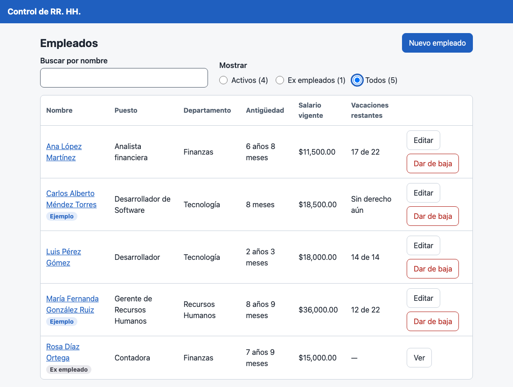 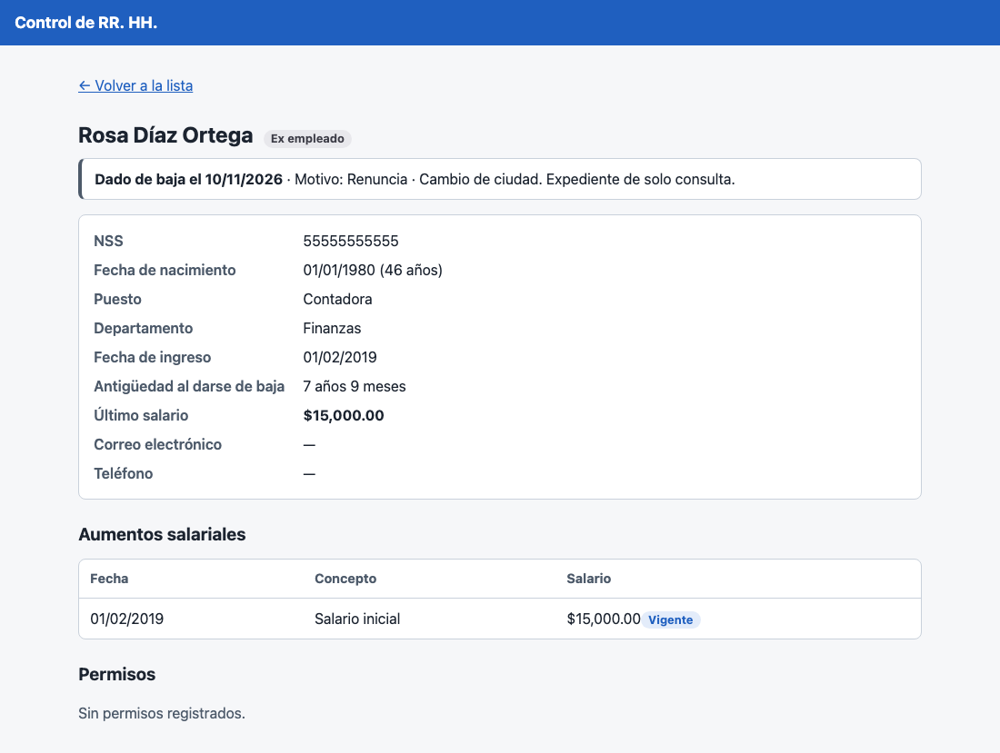

### Iteración 7: panel de resumen de RH
**Prompts:**
> Nuevo requerimiento: Panel de de resumen de RH para apoyar en la toma de decisiones. Debe tener los siguientes indicadores: plantilla activa (total de activos, ¿cuanta gente tengo y cómo cambia?, Nomina mensual vigente (suma de salarios vegentes de los activos), ausencias (quién esta ausente hoy y permisos del mes). Registra el requerimiento y realiza la fase de inception.

> Respuestas: evolución de 12 meses; nómina con total y desglose por departamento; mes en curso fijo; panel como página de inicio.

> Apruebo, adelante con Construction

**Resultado:**
- panel como página de inicio, con menú Panel · Empleados;
- plantilla activa con su evolución de 12 meses;
- nómina vigente por departamento;
- ausentes hoy y permisos del mes.


### Después de la iteración 7
**Prompts:**
> Evalua que se cumplan todos los requerimientos, has un documento con el resultado de la evaluacion y recomendaciones para mejoras futuras.

> Agrega screenshots en el Readme, tambien agrega una seccion donde se vea la evolucion a traves de las iteraciones, y los prompts usados para lograrlo

**Resultado:**
- [`docs/evaluacion-requerimientos.md`](docs/evaluacion-requerimientos.md): los 19 requerimientos se cumplen; incluye observaciones y recomendaciones;
- estas secciones del README;
- la corrección de "1 laborables" → "1 laborable", detectada al revisar las capturas.

## Uso local

```bash
npm install
npm run dev        # servidor de desarrollo
npm test           # pruebas unitarias, de interfaz y de accesibilidad
npm run lint
npm run build      # build de producción en dist/
npm run preview    # sirve el build localmente
```

## Persistencia
La app incluye dos empleados de ejemplo (`src/data/ejemplos.ts`) que se agregan al cargar si faltan; se pueden editar y dar de baja. Los empleados no se eliminan: al darlos de baja quedan como ex empleados de solo consulta.

Los datos se guardan en `localStorage` del navegador (clave `app-rh:datos:v1`). Cada navegador/dispositivo tiene sus propios datos; borrar los datos del sitio los elimina. La persistencia está aislada detrás de la interfaz `Almacenamiento` (`src/data/almacenamiento.ts`) para poder sustituirla por un backend.

## Estructura

```
src/
  domain/      Reglas de negocio puras (validaciones, antigüedad, salario vigente) + pruebas
  data/        Store reactivo y almacenamiento en localStorage
  components/  Campo de formulario accesible, secciones de aumentos y permisos
  pages/       Panel de resumen; lista, formulario, detalle y baja de empleado
  test/        Configuración y pruebas de accesibilidad
docs/
  requerimientos.md   Requerimientos con criterios de aceptación (v1.7)
  inception.md        Plan, modelo de datos y decisiones (AI-DLC: Inception)
  inception-iteracion-2.md  Inception de R3–R5
  inception-iteracion-3.md  Inception de A6 y R6 (vacaciones)
  inception-iteracion-5.md  Inception de R7 (límite de 100 años)
  inception-iteracion-6.md  Inception de A8 y R8 (baja de empleados)
  inception-iteracion-7.md  Inception de A9 (panel de resumen de RH)
  evaluacion-requerimientos.md  Evaluación del cumplimiento y recomendaciones
  evidencias/         Evidencia de verificación de criterios y capturas (app/, evolucion/, iteracion-N/)
  prompts.md          Registro de prompts
```

## Trazabilidad de requerimientos

| Req. | Implementación | Pruebas |
|---|---|---|
| A1, R1 | `pages/ListaEmpleados.tsx`, `pages/FormularioEmpleado.tsx`, `domain/empleado.ts` | `pages/empleados.test.tsx`, `domain/empleado.test.ts` |
| A2, R2a | `components/SeccionPermisos.tsx`, `domain/permiso.ts` | `components/SeccionPermisos.test.tsx`, `domain/permiso.test.ts` |
| A3, R2b | `components/SeccionAumentos.tsx`, `domain/salario.ts` | `components/SeccionAumentos.test.tsx`, `domain/salario.test.ts` |
| A4 | `domain/antiguedad.ts` | `domain/antiguedad.test.ts` |
| R2c | `domain/empleado.ts`, `domain/permiso.ts`, `domain/salario.ts` | pruebas de dominio y `SeccionPermisos.test.tsx` |
| A5 | `components/Campo.tsx`, estilos en `index.css` | `test/accesibilidad.test.tsx`, `docs/evidencias/a5-accesibilidad.md` |
| R3 | `domain/salarioMinimo.ts`, `domain/empleado.ts`, `domain/salario.ts` | `domain/salarioMinimo.test.ts`, pruebas de dominio y `pages/empleados.test.tsx` |
| R4 | `domain/empleado.ts` (`calcularEdad`, `EDAD_MINIMA`) | `domain/empleado.test.ts`, `pages/empleados.test.tsx` |
| R5 | `domain/empleado.ts` (validación de NSS, única entre activos; `exEmpleadoConNss`) | `domain/empleado.test.ts`, `pages/empleados.test.tsx` |
| A6 | `domain/vacaciones.ts`, `components/SeccionVacaciones.tsx`, columna en `pages/ListaEmpleados.tsx` | `domain/vacaciones.test.ts`, `components/SeccionVacaciones.test.tsx` |
| R6 | `domain/permiso.ts` (`validarPermiso`) | `domain/permiso.test.ts`, `components/SeccionPermisos.test.tsx` |
| A7 | `data/ejemplos.ts`, carga en `data/store.ts` | `data/ejemplos.test.ts` (incluye que los ejemplos cumplan R1–R7), `pages/empleados.test.tsx` |
| R7 | `domain/empleado.ts` (`validarEmpleado`, `excesoDeAnios`); avisos en `pages/ListaEmpleados.tsx` y `pages/DetalleEmpleado.tsx` | `domain/empleado.test.ts`, `pages/empleados.test.tsx`, `test/accesibilidad.test.tsx` |
| A8, R8 | `domain/baja.ts`, `store.darDeBaja`, `pages/FormularioBaja.tsx`; filtro en `pages/ListaEmpleados.tsx`; solo consulta en `pages/DetalleEmpleado.tsx` | `domain/baja.test.ts`, `data/store.test.ts`, `pages/empleados.test.tsx`, `test/accesibilidad.test.tsx` |
| A9 | `domain/panel.ts`, `pages/Panel.tsx`, `components/GraficaPlantilla.tsx`; ruta de inicio y menú en `App.tsx` | `domain/panel.test.ts`, `pages/Panel.test.tsx`, `pages/navegacion.test.tsx`, `test/accesibilidad.test.tsx` |

## Mantenimiento anual
El salario mínimo cambia cada 1 de enero. Actualizar `SALARIO_MINIMO` en `src/domain/salarioMinimo.ts` con el monto diario publicado por CONASAMI en el DOF y ajustar la prueba de `salarioMinimo.test.ts`.

## Integración continua
`.github/workflows/ci.yml` corre en cada push y pull request a `main`: `npm ci`, lint, pruebas y build (Node 22).

## Despliegue
El proyecto de Vercel está conectado al repositorio: cada push a `main` despliega a producción y cada pull request genera un despliegue de vista previa. Vercel detecta Vite automáticamente (`npm run build`, salida `dist/`). `vercel.json` redirige todas las rutas a `index.html` para que funcionen las rutas del cliente al recargar.
